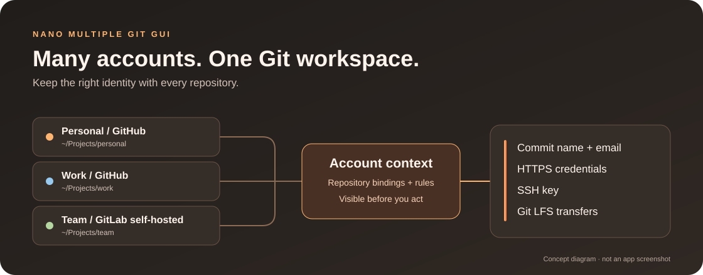

<p align="center">
  
</p>

<h1 align="center">NANO Multiple Git GUI</h1>

<p align="center">
  <b>Your repositories. Your accounts. The right identity, together.</b><br />
  An open-source Git desktop app for working across personal, work and team accounts.<br />
  GitHub and GitLab, side by side, on Windows, macOS and Linux.
</p>

<p align="center">
  <a href="https://github.com/congluuit/NANOMultipleGitGUI/releases"></a>
  <a href="LICENSE"></a>
  
  
</p>

<p align="center">
  <a href="https://github.com/congluuit/NANOMultipleGitGUI/releases"><b>Download</b></a> ·
  <a href="#features">Features</a> ·
  <a href="#get-started">Get started</a> ·
  <a href="#development">Development</a> ·
  <a href="PLAN.md">Knowledge Base</a> ·
  <a href="#tiếng-việt">Tiếng Việt</a>
</p>

<p align="center">
  
  <br />
  <sub>How account context connects your repositories and identities. Concept diagram, not an app screenshot.</sub>
</p>

<table>
  <tr>
    <td width="25%" valign="top">
      <h3>👥 Accounts together</h3>
      Keep several GitHub and GitLab accounts signed in, including enterprise and self-hosted instances.
    </td>
    <td width="25%" valign="top">
      <h3>🧭 Identity per repo</h3>
      Bind each repository to an account, or let folder and remote rules choose for you.
    </td>
    <td width="25%" valign="top">
      <h3>📦 Large files, covered</h3>
      Check large files before committing and manage Git LFS transfers with progress and cancellation.
    </td>
    <td width="25%" valign="top">
      <h3>🔐 Local by design</h3>
      Keep app data on your machine and credentials in the OS keychain. No telemetry.
    </td>
  </tr>
</table>

## Why NANO GUI?

A work repository and a personal project can live on the same Git host while needing different credentials, SSH keys and commit emails. Keeping those choices in sync should be part of the workflow.

**NANO Multiple Git GUI makes the account part of the repository context.** See the active identity, switch it when needed, and use Commit Guard and Push Guard to catch mismatches before continuing. Your repositories share one workspace while keeping their account settings distinct.

## Features

<table>
  <tr>
    <td width="50%" valign="top">
      <h3>Use the account you mean to use</h3>
      Sign in through a browser or a personal access token. Bind accounts per repository or remote, match them by rules, and override the account for an individual commit or push. Create, import and upload SSH keys from the app.
      <br /><br />
      Commit Guard and Push Guard surface identity and access problems before an operation. Browser sign-in requires an OAuth client ID configured for the provider; PAT sign-in is available without one.
    </td>
    <td width="50%" valign="top">
      <h3>Read the history. Shape the next commit.</h3>
      Explore a visual commit graph, inspect diffs, and stage files, hunks or individual lines. Follow file history and blame, amend a commit, or resolve conflicts in a three-way editor.
      <br /><br />
      Branches, tags, merge, rebase, interactive rebase, cherry-pick, revert, reset, stashes, submodules, worktrees and commit signing are available in the same workspace.
    </td>
  </tr>
  <tr>
    <td width="50%" valign="top">
      <h3>Bring large files along</h3>
      Large File Guard checks staged files and outgoing history. Track files with Git LFS, inspect transfer estimates, and follow upload and download progress.
      <br /><br />
      Pause work by cancelling a transfer, then retry it. LFS uses the selected account context alongside Git. Size limits can be configured for your provider.
    </td>
    <td width="50%" valign="top">
      <h3>Stay close to your team</h3>
      Browse repositories across accounts, fork and clone, and work with GitHub pull requests or GitLab merge requests: read, comment, review, create, check out and merge.
      <br /><br />
      Browse issues, create a branch from an issue, and gather assigned issues and review requests in My Work. Enable CI status when you want it.
    </td>
  </tr>
  <tr>
    <td width="50%" valign="top">
      <h3>Make room for your workflow</h3>
      Open a terminal with the repository's account context, reach actions through the command palette, and keep tagged personal notes in My Work.
      <br /><br />
      Optional AI commit messages support OpenAI, Anthropic, Gemini, OpenAI-compatible endpoints and local Ollama. AI suggestions are off by default.
    </td>
    <td width="50%" valign="top">
      <h3>Make it feel like home</h3>
      Choose Light, Dark, System or a custom theme, including high-contrast presets. Resize panels and switch between English and Vietnamese.
      <br /><br />
      Export account settings or create an encrypted app-data backup. Restore settings on another computer, manage storage locations, and find feature explanations in the built-in Full Guide.
    </td>
  </tr>
</table>

## Get started

Download a build from **[GitHub Releases](https://github.com/congluuit/NANOMultipleGitGUI/releases)**. The assets attached to each release are the source of truth for available builds and signing status.

| Platform | Package formats                              | Installation guide                         |
| -------- | -------------------------------------------- | ------------------------------------------ |
| Windows  | Setup `.exe`, `.msi`                         | [Windows](docs/INSTALL-Windows.md)         |
| macOS    | Universal `.dmg` for Apple Silicon and Intel | [macOS](docs/INSTALL-macOS.md)             |
| Linux    | `.AppImage`, `.deb`, `.rpm`                  | Pick the format matching your distribution |

Unsigned builds may trigger an operating-system warning; see the installation guides for details. Git is required, and Git LFS is needed for LFS workflows. The first-run tool check helps detect missing tools.

1. Add a GitHub or GitLab account, using browser sign-in or a personal access token.
2. Open a local repository or clone one from your accounts.
3. Check the account shown for the repository and select its commit identity.
4. Review changes, stage, commit, then push.

## Under the hood

A **Tauri 2** desktop shell connects a **React 19 + TypeScript** interface to a **Rust** backend. Git operations run through the system Git CLI, using the repository's account context for identity and authentication.

| Area                | Implementation                                             |
| ------------------- | ---------------------------------------------------------- |
| Interface           | React, Tailwind CSS, Radix UI, Monaco Editor, xterm.js     |
| State and IPC       | Zustand, TanStack Query, generated Tauri/Specta bindings   |
| Git and large files | System Git CLI, Git LFS CLI, per-account credential helper |
| Local data          | SQLite for app data; OS keychain for secrets               |
| Localization        | i18next, English and Vietnamese                            |

For the module map, account resolution rules and data flows, read the **[Knowledge Base](PLAN.md)** (Vietnamese). Technical decisions live in [Architecture Decision Records](docs/adr/).

## Privacy and security

The project operates no application servers and currently collects no telemetry. Settings and repository metadata stay on your computer; access tokens, refresh tokens, SSH passphrases and AI API keys use the operating-system keychain.

Network access supports your configured Git remotes, provider APIs, avatars, update checks and requested tool downloads. If you enable cloud AI suggestions, requesting a message sends staged changes, the branch name and recent commit titles to the selected service. Ollama can run locally; check the endpoint you configure.

Account exports and app backups use password-based encryption. These back up app data and selected credentials; **they do not replace backups of your Git repositories**.

Read [PRIVACY.md](PRIVACY.md) for data handling and [SECURITY.md](SECURITY.md) to report a vulnerability privately.

<a id="hướng-dẫn-phát-triển"></a>

## Development

| Requirement         | Version / setup                                                                                                   |
| ------------------- | ----------------------------------------------------------------------------------------------------------------- |
| Node.js             | 20.19 or newer                                                                                                    |
| pnpm                | 9.15.9, pinned in `package.json`                                                                                  |
| Rust                | Stable, 1.90 or newer                                                                                             |
| Git / Git LFS       | Git 2.35+ / Git LFS 3.0+ recommended for the documented workflows                                                 |
| Native dependencies | C++ Build Tools + WebView2 on Windows; Xcode Command Line Tools on macOS; WebKitGTK and related packages on Linux |

Install the native dependencies described in the [Tauri prerequisites](https://v2.tauri.app/start/prerequisites/), then:

```bash
git clone https://github.com/congluuit/NANOMultipleGitGUI.git
cd NANOMultipleGitGUI
pnpm install
pnpm dev
```

```bash
pnpm build        # Create desktop bundles for the current OS
pnpm check        # Formatting, lint, types, frontend tests, Clippy and Rust tests
pnpm dev:web      # Frontend only; desktop integrations require Tauri
```

Optional OAuth and update configuration is documented in [.env.example](.env.example). Build output is under `target/release/bundle/`. See [CONTRIBUTING.md](CONTRIBUTING.md) for contribution guidelines and [docs/RELEASING.md](docs/RELEASING.md) for releases.

## Documentation and community

| Looking for…                                               | Start here                                                              |
| ---------------------------------------------------------- | ----------------------------------------------------------------------- |
| Architecture, account context, storage and troubleshooting | [Project Knowledge Base](PLAN.md)                                       |
| Design decisions and their tradeoffs                       | [ADRs](docs/adr/)                                                       |
| Changes between releases                                   | [Changelog](CHANGELOG.md)                                               |
| Bugs and feature requests                                  | [GitHub Issues](https://github.com/congluuit/NANOMultipleGitGUI/issues) |
| Contribution workflow                                      | [Contributing](CONTRIBUTING.md) · [Code of Conduct](CODE_OF_CONDUCT.md) |

## Tiếng Việt

**NANO Multiple Git GUI** là ứng dụng Git mã nguồn mở cho Windows, macOS và Linux, tập trung vào việc dùng nhiều tài khoản GitHub/GitLab trong cùng một nơi làm việc.

Mỗi repository có ngữ cảnh tài khoản riêng: danh tính commit, thông tin xác thực HTTPS, SSH key và thao tác LFS. Bạn có thể gán tài khoản thủ công, dùng quy tắc theo thư mục/remote, hoặc đổi tài khoản cho một lần thao tác. Commit Guard và Push Guard giúp phát hiện sai lệch trước khi tiếp tục.

- **Git hằng ngày:** sơ đồ lịch sử, diff, stage từng file/hunk/dòng, quản lý nhánh, rebase tương tác, giải quyết conflict, stash, worktree và submodule.
- **Làm việc nhóm:** PR/MR, issue, fork & clone, My Work và trạng thái CI tùy chọn.
- **Cá nhân hóa:** giao diện Anh–Việt, theme sáng/tối/tùy chỉnh, terminal, ghi chú và gợi ý commit bằng AI tùy chọn.
- **Dữ liệu:** lưu trên máy, bí mật trong keychain hệ điều hành, xuất cấu hình và sao lưu dữ liệu ứng dụng bằng file mã hóa. Sao lưu ứng dụng không bao gồm nội dung repository.

**Bắt đầu:** [tải bản phát hành](https://github.com/congluuit/NANOMultipleGitGUI/releases), thêm tài khoản, mở hoặc clone repo, rồi kiểm tra danh tính trước khi commit/push. Đăng nhập trình duyệt cần OAuth client ID; có thể dùng PAT nếu bản build chưa cấu hình OAuth.

Xem [hướng dẫn cài Windows](docs/INSTALL-Windows.md), [macOS](docs/INSTALL-macOS.md) và **[Knowledge Base tiếng Việt](PLAN.md)** để hiểu kiến trúc, cơ chế tài khoản, cách phát triển và xử lý lỗi.

## Support the project

Bug reports, documentation, translations and contributions all help the project grow. If you would like to support development financially:

<details>
  <summary>Donate via BIDV · Ủng hộ dự án</summary>
  <p align="center">
    
  </p>
</details>

## License

[Apache License 2.0](LICENSE). See [NOTICE](NOTICE) for attribution notices.
